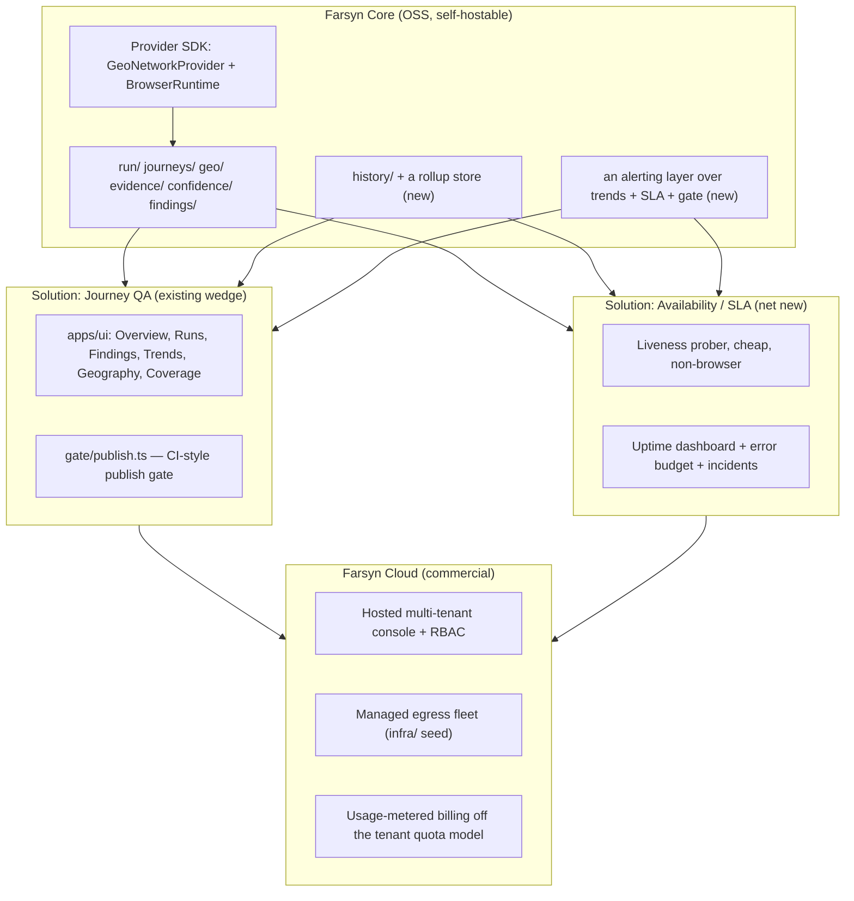

# Product strategy — Farsyn as "the Grafana of journeys"

A positioning document, not a spec: what Farsyn already is structurally, why the
Grafana analogy holds past the marketing line, what is genuinely missing to make
it hold at product scale, and the phased path from the current OSS engine to a
commercial layer on top of it. Requirements are `prd.md`'s `R-`numbers; rules are
`AGENTS.md`'s numbered invariants. Both are cited, not restated — this document
makes a business case out of decisions already load-bearing in the code, and
proposes the ones that are not.

Related: [architecture](architecture.md) · [PRD](prd.md) · [gaps](gaps.md) ·
[SLA spec](sla.md) · [milestone](milestone.md)

---

## 1. The positioning

Grafana's product isn't the charts. It's four decisions that took years to get
right: a datasource abstraction that decouples the UI from any one backend, a
disciplined treatment of missing-vs-zero data, an alerting layer on top of time
series, and an OSS-core/Cloud-commercial split that funds the core without
gating it.

Farsyn already has the hard, structural half of that — in several places more
rigorously than Grafana itself, because it was built as a set of enforced
invariants rather than a UI convention. What it does not have yet is the parts
that turn a well-built engine into a category: alerting, a hosted multi-tenant
layer, and an availability product to sit next to the journey product. This
document is about closing that gap deliberately, not about the analogy for its
own sake.

## 2. Why the analogy holds structurally

| Grafana's decision | Farsyn's equivalent | Where |
|---|---|---|
| A datasource plugin abstraction | `GeoNetworkProvider` (egress) and `BrowserRuntime` (automation engine) are the same pattern, typed and boundary-enforced rather than convention | [`network/types.ts`](../packages/engine/src/network/types.ts), [`browser/types.ts`](../packages/engine/src/browser/types.ts) |
| Null vs. zero handling, imperfect and per-panel | `Measured<T>` makes "we could not look" a different **type**, not a falsy value, everywhere a UI renders a number | [`report/measured.ts`](../packages/engine/src/report/measured.ts) (R-148, R-149) |
| A verdict/alert state model | Three-valued verdicts on every axis (`match` / `mismatch` / `unverified`), never collapsed; `overall` confidence capped by the weakest axis, never averaged | AGENTS.md invariants 4 & 8; R-3 |
| Correlating a metric spike to a trace to a log line — three products wired together (Grafana + Tempo + Loki) | One run **is** the correlation key: the evidence package already carries the screenshot, HAR, trace, console log and a11y tree for the same run the metric came from | [architecture.md §6](architecture.md) |
| A versioned dashboard/API schema | `FARSYN_SCHEMA_VERSION`, stamped by the writer, bumped only on a breaking change | R-95, R-96 |
| — (Grafana has no equivalent) | Every run is replayable from a seed — a metric is a historical fact, a Farsyn run is a flight recorder | AGENTS.md invariant 15; R-60 |

The verdict discipline (row 3) is the single best asset to lead with commercially.
Most competitors, Grafana included, quietly average uncertainty away; Farsyn
cannot, by construction, and that is a claim provable by reading the type
signatures rather than trusting the copy.

## 3. What is actually missing

Read against [`gaps.md`](gaps.md), [`audit-2026-08-18.md`](audit-2026-08-18.md)
and [`sla.md`](sla.md), the gap to "Grafana-grade" is specific, not vague:

- **No alerting.** A daily digest email (`mail/`) and a publish gate
  (`gate/publish.ts`) each judge one thing at one moment. Nothing watches a
  *trend* or an *error budget* continuously and notifies within minutes.
  `report/trends.ts` already computes regressions (`findRegressions`) — nothing
  consumes that signal in real time yet.
- **No continuous/durable operation at production reliability.** Per
  `architecture.md` §9 and `gaps.md` D-2, the Temporal matrix workflow exists and
  is, in practice, unstartable — nothing calls it, and where it can run it is
  sequential-only against the in-process runner's bounded concurrency. A hosted
  product cannot launch on a durable path nobody can drive.
- **No time-series/rollup store.** `history/runs.jsonl` is a derived cache
  (R-129, R-130) — correct as an audit trail, but it does not scale to months of
  multi-tenant history the way a Trends view or an SLA error-budget calculation
  needs.
- **No SLA/uptime capability**, though it is fully specified and unbuilt end to
  end in [`sla.md`](sla.md): a liveness prober, three-vantage quorum, an error
  budget, incident records joined to the nearest evidence package. This is the
  closest analog to Grafana's synthetic-monitoring product, and the spec already
  exists step by step — it is scoping work, not invention.
- **No plugin ecosystem at the product surface.** Extension today is a
  code-level wiring checklist in `AGENTS.md` (correct for an OSS core); there is
  no publishable SDK a third party could ship a provider against without
  forking the repo.
- **Single-admin auth, no RBAC/org model.** `server/` is one admin password plus
  a session — fine for self-hosting, not sufficient for a multi-tenant SaaS.

## 4. Two solutions, one core

Both solutions share the same verdict discipline, the same tenant/quota/security
model (`tenant/`), and — once built — the same alerting layer. The point of one
core is structural: "a journey regressed" and "the site is down" are the same
kind of event underneath, so they should not need two products to detect and
route.

## 5. Differentiation, stated plainly

For when someone asks "why not just use Grafana (plus a synthetics plugin)":

- Grafana visualizes signal you already have. Farsyn *generates* the signal — it
  drives the browser. It sits closer to synthetic monitoring + RUM + visual
  regression, carrying Grafana-grade UI discipline, not a Grafana plugin
  competing on panels.
- The three-valued verdict model and capped confidence are a genuine
  intellectual product, not a UI theme. The pitch: "no chart here averages away
  doubt."
- Every run is replayable from a seed. Nothing in the Grafana/Datadog/Prometheus
  world offers this, because their subject is a historical fact, not a
  reproducible action.

## 6. Trust surface, integrations, and AI workflows

Grounded in what already exists so this proposes *extensions*, not rebuilds.

### 6.1 SBOM — two distinct ideas under one name

1. **Tool-provenance SBOM** (compliance/trust, self-referential). An evidence
   package already answers "what happened, where, when"
   (`REQUIRED_QUESTIONS` in [`evidence/manifest.ts`](../packages/engine/src/evidence/manifest.ts))
   but not "which exact build of Farsyn, and which exact dependency versions,
   produced this verdict." Generate a CycloneDX/SPDX SBOM for `packages/engine`
   (and the pinned `agent-browser`/Playwright versions) in CI, and stamp it into
   the manifest the same way `FARSYN_SCHEMA_VERSION` is stamped — one constant,
   written by the writer, never supplied by a caller (R-95, R-96's pattern). A
   CI step and a manifest field, not a subsystem, and a direct answer to an
   enterprise security questionnaire: "prove what ran."
2. **Target-site third-party-script inventory** (a genuinely new finding
   category). A journey already reads the page through the browser; nothing
   inventories the third-party scripts it loads (src, host, and, where exposed,
   a version string) or flags a known-vulnerable one. This is the new
   capability: a `third-party-inventory` check kind feeding a `supply-chain`
   finding category through the *same* pipeline every other finding already
   uses (`findings/classify.ts` → `findings/tickets.ts` → the GitHub/Linear
   routing in §6.3). A capability Grafana has no opinion about at all, which
   makes it a real differentiator rather than a catch-up feature. Guardrail: a
   version match from string-sniffing is heuristic and must say so —
   `match` / `unverified`, never a silent zero, the same discipline as every
   other axis (R-3, R-33).

### 6.2 Alerting — separate from filing, which already exists

`fix/` and `findings/` already form a mature **filing and repair** pipeline:
intake from three sources (`fix/types.ts`'s `WorkSource` — growth-fleet Postgres,
Farsyn's own `filed-issues.json`, and a GitHub issue a human opted in with
`agent: approved`, [`fix/intake-github.ts`](../packages/engine/src/fix/intake-github.ts))
→ triage and budget (`fix/triage.ts`, `fix/select.ts`) → routing to the right
repo (`fix/route.ts`, `findings/repos.ts`) → a `claude -p` repair
([`assist/repair.ts`](../packages/engine/src/assist/repair.ts)) → review
(`fix/review.ts`) → verify against the target's own CI (`fix/verify.ts`) → merge,
summarised in a daily digest email (`digest/summary.ts`). None of that pages
anyone in real time — it is async by design.

**Alerting is the missing, different thing**: a live signal, watched
continuously, that notifies within minutes. Build it as a thin layer over pure
functions that already exist — `findRegressions`
([`report/trends.ts`](../packages/engine/src/report/trends.ts)), the SLA
error-budget thresholds once built (`sla.md` §6: 50% of budget consumed, any
single incident over 10 minutes), and the publish gate's `block`/`unknown`
verdicts (`gate/publish.ts`) — fanned out to channels: `mail/` first (it already
sends), then one generic outbound webhook so Slack, PagerDuty and Linear are an
HTTP call away rather than a bespoke integration each, mirroring the
"one interface, many providers" shape `GeoNetworkProvider` already uses.

Keep filing and alerting conceptually separate, the way the codebase keeps
distinct things distinct elsewhere: a ticket says something has an owner and a
fix path; an alert says something needs a human *now*. Conflating them turns
every noisy signal into a page.

### 6.3 Linear, alongside GitHub, and issue templates made explicit

GitHub is a full first-class citizen today; Linear is not represented in the
tree at all. The clean way in matches the pattern already established rather
than inventing a new one:

- `fix/types.ts`'s `WorkSource` is already `"growth" | "farsyn" | "github"`. A
  fourth `"linear"` source, a `findings/linear.ts` mirroring
  `findings/github.ts`'s shape (create, label/state update, a list call for the
  same opt-in-via-label intake pattern `fix/intake-github.ts` establishes), and
  a routing entry in `findings/repos.ts` / `fix/route.ts` so a tenant can say
  "this site's tickets go to Linear team X" the same way it names a GitHub repo
  today. Both become one `WorkItem` before triage — the stated reason that type
  exists — so triage, budget and dedup do not need to know which backend fired.
- **Issue templates already exist, informally.** `findings/brief.ts`'s
  `formatBrief` / `prBody` are the template — a fixed eight-section shape every
  ticket and every repair PR body is built from. Making that explicit means:
  naming and versioning it the way the wire contract is versioned, so a
  template edit does not silently reshape every filed issue with no record;
  letting a tenant register a different template per finding category (a
  `supply-chain` finding reads differently to a security team than a
  `functional` one does to a content team) as tenant data
  (`inputs/tenants/<id>.yaml`, the same reasoning as R-118 — a non-engineer can
  edit it, it diffs in review); and rendering one template to both GitHub
  markdown and Linear's format from one pure function, which matters more here
  than almost anywhere else in the codebase, because now two backends read it.

### 6.4 AI skills, workflows, and an AI assistant — extend the boundary, don't cross it

The important constraint first: there is already a working AI-driven fix loop
(`assist/` + `fix/`), and it already sits exactly where the architecture
demands — strictly *after* a verdict exists, never on the measurement path.
`assist/repair.ts`'s own header says so: a model on the measurement path would
make a failing run unreproducible. Two things are genuinely missing, and both
extend that boundary rather than duplicate what is inside it:

1. **Packaged skills, not just internal CLI commands.**
   `farsyn assist explain <runId>` and the repair pipeline are only reachable
   from inside this repo. A `skills/` directory of `SKILL.md`-style packages —
   "triage a Farsyn finding," "write a new journey spec against
   `journeys/spec.ts`'s schema," "explain an SLA incident from its attached
   evidence package" — makes the same `claude -p` / `assist/claude.ts` machinery
   usable by any AI coding agent working in a tenant's own repository. This is
   also a natural OSS artifact for an open-source push: skills are inherently
   shareable, and this one is a real platform capability rather than marketing
   collateral.
2. **An interactive assistant surface in the console**, not just a batch
   `assist explain`. Scoped to one run or one finding, read-only over the
   evidence package, wired the same way `assist/` already is — downstream of
   the verdict, never a participant in producing it. Concretely: a chat panel
   on a run-detail or finding-detail view in [`apps/ui/src/views/`](../apps/ui/src/views/)
   calling the existing explain pipeline conversationally, extending naturally
   into drafting a *first* answer for the issue template above — a human still
   opens the ticket.

**Guardrail specific to this area, and the one that matters most**: nothing here
may shorten the gap between "a model suggested it" and "a human approved it" for
anything that touches a live site. The repair pipeline already gets this right —
`agent: approved` is written by a human and only ever *read* by the agent
(`fix/intake-github.ts`'s own header: an agent that can grant itself permission
has none). Any new skill or assistant surface extends that one gate; it does not
add a second path around it.

## 7. Phased roadmap

**Phase 0 — the trust and integration surface.**
- SBOM: a CI step producing a CycloneDX SBOM for `packages/engine`, stamped into
  the evidence manifest; separately, a `third-party-inventory` check kind and
  `supply-chain` finding category over what a journey already reads.
- Linear as a fourth `WorkSource` alongside GitHub, sharing `WorkItem`, triage,
  budget and dedup.
- The existing `brief.ts` template made explicit, named, versioned, and
  overridable per tenant per finding category.
- A real-time alerting layer over `findRegressions` and the gate's
  `block`/`unknown` verdicts, via `mail/` then a generic webhook — kept
  conceptually separate from the filing/repair pipeline that already exists.
- A `skills/` package for the existing `assist/` machinery, plus an
  interactive, read-only assistant panel in the console — both strictly
  downstream of the verdict, both respecting the human-approval gate the repair
  pipeline already enforces.

**Phase A — close the reliability gap, ship the spec'd SLA capability.**
- Fix the durable-path gaps blocking any hosted/continuous product: a workflow
  client entrypoint, concurrency parity between the in-process and durable
  matrix runners (`gaps.md` D-2, `architecture.md` §9).
- Build `sla.md` in its own stated order: liveness prober + JSONL storage →
  quorum across vantages → monthly rollup (availability + coverage) → incident
  records joined to the nearest evidence package. The fastest path to a net-new
  "synthetic monitoring" analog, and it is already fully specified.
- Add a minimal alerting primitive reusing what exists: feed `findRegressions`
  and the SLA error-budget thresholds (50% consumed; any incident over 10
  minutes, per `sla.md` §6) into a notification — start with the existing
  `mail/` digest channel, then add a generic webhook so Slack/PagerDuty are one
  HTTP call away, not a new subsystem per integration.

**Phase B — productize the extensibility.**
- Publish `GeoNetworkProvider` and `BrowserRuntime` as a documented, versioned
  provider SDK (OSS) so a third party can ship a new egress provider or engine
  without forking — the same typed, boundary-enforced pattern the codebase
  already uses internally, just exposed.
- Add a queryable rollup store behind Trends and the SLA rollup, without
  replacing `runs.jsonl` as the audit trail (R-129 stays true) — a rollup is a
  cache over it, the same relationship the run index already has to the
  evidence tree.
- RBAC/org model in `server/`, beyond one admin password, as the prerequisite
  for multi-tenant SaaS auth.

**Phase C — Farsyn Cloud (the commercial layer).**
- Managed egress fleet, metered the way `tenant/quota.ts` and the usage-probe
  already track traffic — `infra/`'s VM provisioning is the seed to scale into
  "verified vantage points" as a sellable unit.
- Hosted multi-tenant console with billing tied to the existing quota model.
- Sell the SLA capability on the evidence-backed incident report as the
  differentiator against commodity uptime monitors and against Grafana Cloud's
  own synthetic checks, neither of which drives a real geo-distributed browser
  or attaches a screenshot/HAR/trace to the incident.

## 8. Guardrails

Things not to build, matching the project's existing design-refusal culture:

- No generic build-your-own-panel canvas chasing Grafana's flexibility — it
  fights the "console is scanned, not read" doctrine already encoded in the UI
  (R-179, R-180). Ship curated views plus a stable API for power users to build
  externally.
- No LLM in the measurement path, ever (existing hard invariant) — worth
  stating explicitly as a trust differentiator against "AI QA" competitors, not
  just an internal rule.
- No averaging across SLA vantages without quorum, no folding `unmeasured` into
  either neighbour — the same discipline the geo verdicts already enforce
  (invariant 4), applied to uptime.
